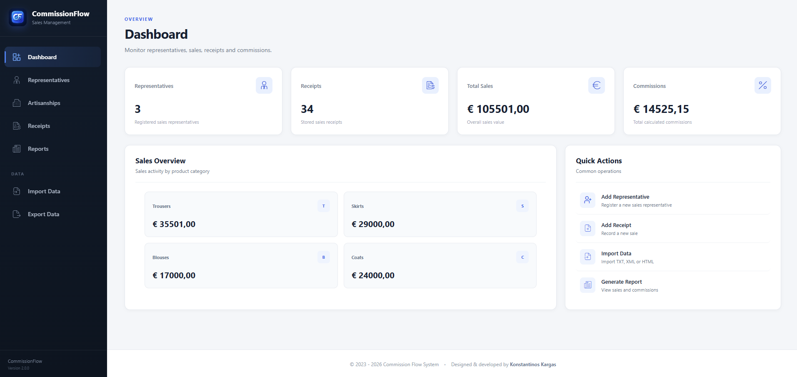
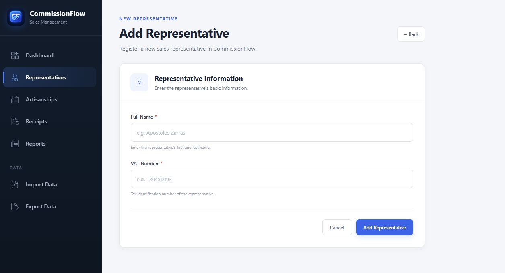
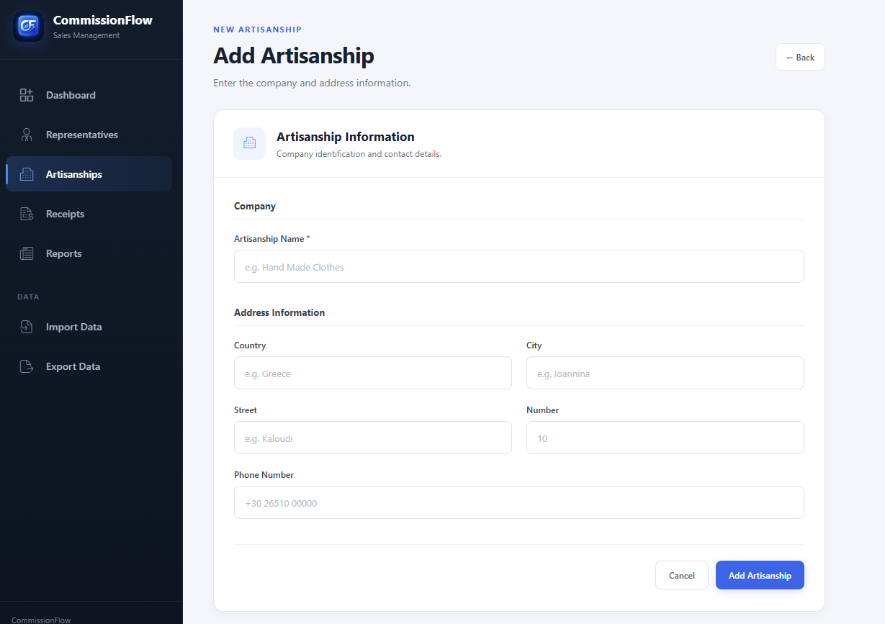
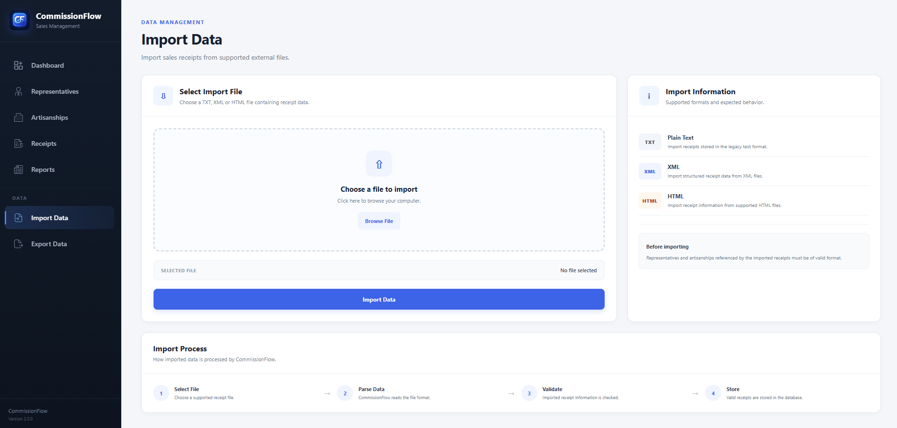
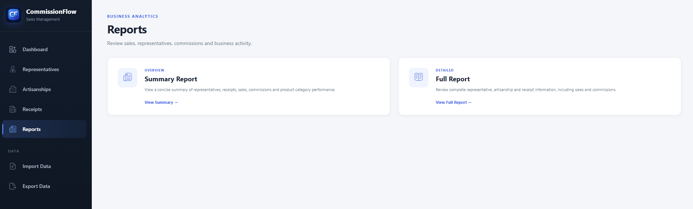

<div align="center">
  

# CommissionFlow

**Sales & Commission Management System**

A Spring Boot web application for managing sales representatives, receipts, artisanships, sales statistics, commissions, reports, and structured data import/export.

</div>

## Overview

CommissionFlow is a reengineered sales and commission management application built with Spring Boot, Thymeleaf, Spring Data JPA, and SQLite. It provides a browser-based interface for maintaining sales data and calculating representative commissions while supporting TXT, XML, and semantic HTML data interchange.

The project focuses on a clean layered architecture, relational data management, import/export workflows, duplicate handling, reporting, and a responsive business-oriented user interface.

## Features

- Dashboard with representative count, receipt count, total sales, total commissions, and sales by category.
- Representative management with create, edit, delete, and per-representative sales overview.
- Receipt management with unique receipt codes, sales date, category, value, item count, representative, and artisanship assignment.
- Artisanship management with linked address information.
- Automatic commission calculation based on sales thresholds.
- Summary and full business reports.
- Import of representative receipt data from **TXT**, **XML**, and **HTML** files.
- Duplicate-aware import logic:
  - exact duplicates are skipped;
  - conflicting receipt codes with different data are assigned a new available code;
  - missing representatives and artisanships can be created during import.
- Export of one representative or all representatives in **TXT**, **XML**, or **HTML** format.
- Bulk export as a ZIP archive.
- Manual duplicate receipt-code validation when creating or editing receipts.
- Cascade-aware delete behavior for related records.
- Responsive server-rendered UI using Thymeleaf and custom CSS.

## Tech Stack

| Layer | Technology |
| --- | --- |
| Backend | Java 21, Spring Boot 4.1.1 |
| Web | Spring MVC, Thymeleaf |
| Persistence | Spring Data JPA, Hibernate |
| Database | SQLite |
| Parsing | Jsoup |
| Build | Maven / Maven Wrapper |
| Frontend | HTML5, CSS3, Thymeleaf |

## Domain Model

CommissionFlow is centered around four main entities:

- **Representative** — sales representative identified by name and unique VAT number.
- **Receipt** — sales record containing code, date, category, sales value, item count, representative, and artisanship.
- **Artisanship** — company/workshop associated with a receipt.
- **Address** — address information owned by an artisanship.

Relationship overview:

```text
Representative 1 ──────── * Receipt * ──────── 1 Artisanship
                                              │
                                              │ 1:1
                                              ▼
                                           Address
```

Deleting a representative removes its receipts. Deleting a receipt does not remove its representative or artisanship. Deleting an artisanship removes receipts that reference it and also removes its linked address.

## Receipt Categories

The application currently supports:

- Trousers
- Skirts
- Blouses
- Coats

## Commission Rules

Commission is calculated from the representative's total sales:

| Total sales | Commission |
| --- | --- |
| Up to €6,000 | €0 |
| €6,000–€10,000 | 10% of the amount above €6,000 |
| €10,000–€40,000 | 10% of the first €10,000 + 15% of the remaining amount |
| Above €40,000 | 10% of the first €10,000 + 15% of the next €30,000 + 20% of the remaining amount |

## Import / Export

CommissionFlow supports the original project data format in three representations.

### TXT

```text
Name: Apostolos Zarras
AFM: 130456093
Receipts:
Receipt ID: 1001
Date: 25/2/2026
Kind: Coats
Sales: 2000
Items: 10
Company: Hand Made Clothes
Country: Greece
City: Ioannina
Street: Kaloudi
Number: 10
```

### XML

```xml
<Agent>
    <Name>Apostolos Zarras</Name>
    <AFM>130456093</AFM>
    <Receipts>
        <Receipt>
            <ReceiptID>1001</ReceiptID>
            <Date>25/2/2026</Date>
            <Kind>Coats</Kind>
            <Sales>2000</Sales>
            <Items>10</Items>
            <Company>Hand Made Clothes</Company>
            <Country>Greece</Country>
            <City>Ioannina</City>
            <Street>Kaloudi</Street>
            <Number>10</Number>
        </Receipt>
    </Receipts>
</Agent>
```

### Semantic HTML

```html
<ul class="representative">
    <li data-field="name">Apostolos Zarras</li>
    <li data-field="afm">130456093</li>
</ul>

<section class="receipt">
    <ul>
        <li>Receipt ID: 1001</li>
        <li>Date: 25/2/2026</li>
        <li>Kind: Coats</li>
        <li>Sales: 2000</li>
        <li>Items: 10</li>
        <li>Company: Hand Made Clothes</li>
        <li>Country: Greece</li>
        <li>City: Ioannina</li>
        <li>Street: Kaloudi</li>
        <li>Number: 10</li>
    </ul>
</section>
```

Ready-to-use examples are included in [`samples/import`](samples/import).

## Project Structure

```text
src/main/java/com/kkargas/sales/
├── controller/     MVC controllers
├── enums/          Receipt categories
├── exporter/       TXT, XML and HTML exporters
├── importer/       TXT, XML and HTML importers
├── model/          JPA entities
├── repository/     Spring Data repositories
└── service/        Business logic and reporting

src/main/resources/
├── static/
│   ├── css/
│   └── images/
├── templates/
│   ├── artisanships/
│   ├── dashboard/
│   ├── export/
│   ├── fragments/
│   ├── import/
│   ├── receipts/
│   ├── reports/
│   └── representatives/
└── application.properties
```

## Getting Started

### Requirements

- Java 21 or newer
- No external database server is required

### Run with Maven Wrapper

Clone the repository and enter the project directory:

```bash
git clone <your-repository-url>
cd CommissionFlow
```

On Windows:

```cmd
mvnw.cmd spring-boot:run
```

On Linux/macOS:

```bash
./mvnw spring-boot:run
```

Then open:

```text
http://localhost:8080
```

The application redirects the root URL to the dashboard.

## Database

CommissionFlow uses a local SQLite database configured as:

```properties
spring.datasource.url=jdbc:sqlite:commissionsales.db
```

The database file is intentionally excluded from version control. Hibernate is configured with `ddl-auto=update`, so the schema is created/updated when the application starts.

## Build

Create the executable Spring Boot JAR with:

```bash
./mvnw clean package
```

On Windows:

```cmd
mvnw.cmd clean package
```

The generated artifact will be placed in the `target/` directory.

## Screenshots

### Dashboard



### Representatives



### Artisanships



### Import Data



### Reports



## Notes on Data Integrity

- Representative VAT numbers are unique.
- Receipt codes are unique.
- Manual receipt entry prevents saving a duplicate receipt code.
- Imported exact duplicates are skipped.
- Imported code conflicts with different receipt data are resolved by allocating a new receipt code.
- An artisanship is distinguished using both company and address information, allowing companies with the same name at different locations.

## Background

CommissionFlow is a modern reengineering of an earlier university sales-and-commission management project. The original desktop-oriented concept was redesigned as a Spring Boot web application with a relational persistence layer, structured import/export support, reporting, and a modern user interface.

## Author

**Konstantinos Kargas**  
Full-Stack Software Developer

- GitHub: `KonKargas`
- Portfolio: `kkargas.com`

## License
-
