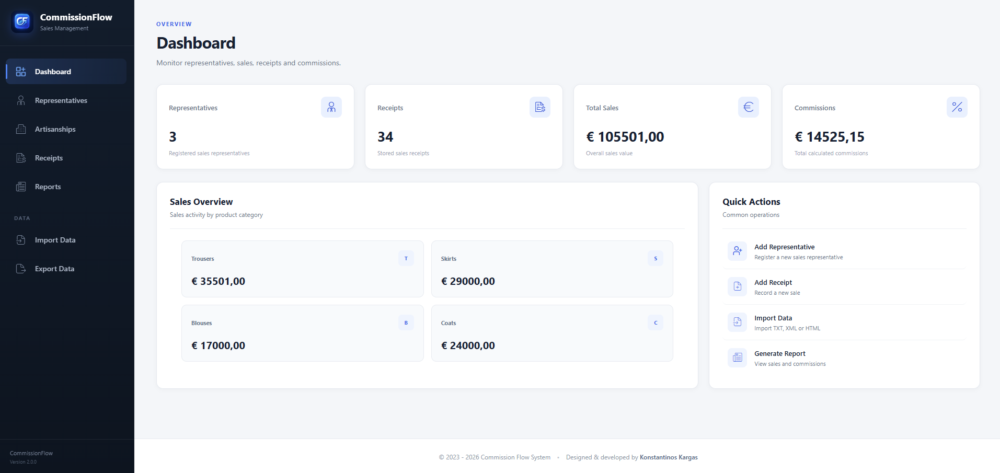
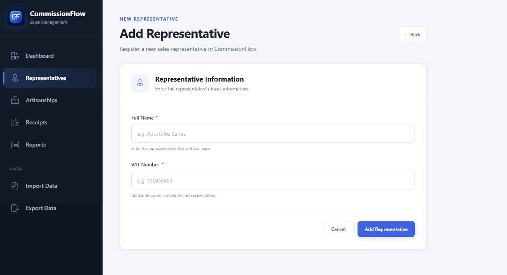
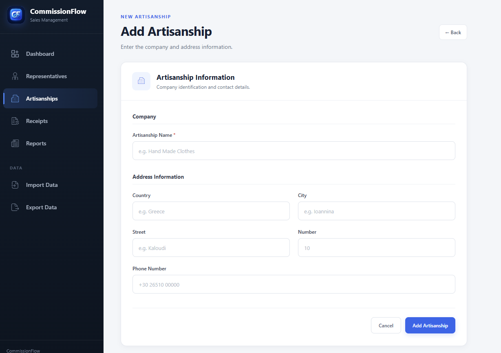
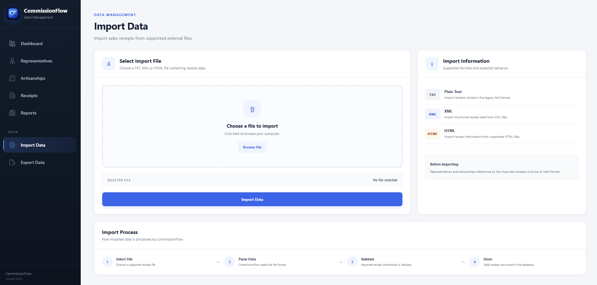
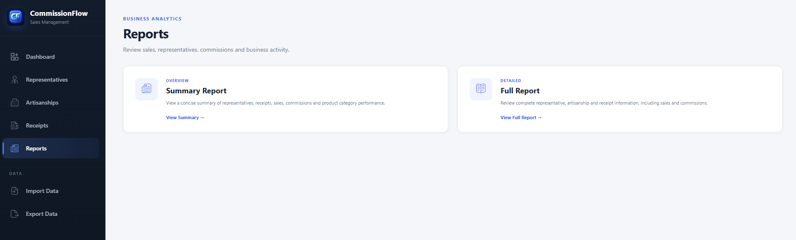

<div align="center">


# CommissionFlow

### Sales & Commission Management System

A full-stack business application for managing representatives, receipts, artisanships, commission calculations, reporting, and structured data exchange.

**Java 21** · **Spring Boot 4.1.1** · **Thymeleaf** · **Spring Data JPA** · **SQLite** · **Maven**

[Overview](#project-overview) · [Features](#core-features) · [Technology Stack](#technology-stack) · [Screenshots](#application-screenshots) · [Installation](#installation--usage)

</div>

---

## Project Overview

**CommissionFlow** is a Java-based, server-rendered web application for organizing sales data and calculating representative commissions. It replaces an earlier university desktop-oriented concept with a structured Spring Boot application, relational persistence, and a responsive browser interface.

The platform brings together sales representatives, receipts, artisanships, sales statistics, and reports. Its import and export workflows are designed to preserve data integrity, including when incoming files contain existing receipt identifiers or previously unseen related entities.

### Core Features

| Module | Capabilities |
|---|---|
| **Dashboard** | Overview of representatives, receipts, aggregate sales, commissions, and sales distribution by category. |
| **Representatives** | Create, edit, and delete representatives; maintain unique VAT numbers; review individual sales records and performance. |
| **Receipts** | Record and update receipt codes, dates, categories, amounts, item counts, representatives, and associated artisanships. |
| **Artisanships** | Manage companies or workshops and their related address details. |
| **Commission Calculation** | Automatically calculate representative commissions using progressive sales thresholds. |
| **Business Reports** | View aggregate and detailed reports covering sales and commissions. |
| **Data Import** | Import representative and receipt records from TXT, XML, and semantic HTML files. |
| **Data Export** | Export individual representatives or all representatives to TXT, XML, and HTML; package bulk exports in ZIP archives. |
| **Data Integrity** | Prevent duplicate receipt codes during manual entry, skip exact duplicates during import, and resolve conflicting imported identifiers. |

### Selected Capabilities

- **Structured entity relationships:** receipts are associated with representatives and artisanships, while artisanships have linked address records.
- **Duplicate-aware importing:** exact duplicates are skipped; conflicting receipt codes containing different data are reassigned an available identifier.
- **Related-record creation:** import routines can create representatives and artisanships missing from the database.
- **Validation:** unique representative VAT numbers and receipt codes help maintain consistent records.
- **Cascade-aware deletion:** related records are handled according to the application's domain rules.
- **Responsive interface:** Thymeleaf templates and custom CSS support browser-based workflows.
- **Example import files:** ready-to-use sample data can be found in [`samples/import`](samples/import).

---

## Technology Stack

| Layer | Technologies |
|---|---|
| **Backend** | Java 21, Spring Boot 4.1.1, Spring MVC |
| **Frontend** | Thymeleaf, HTML5, CSS3 |
| **Persistence** | Spring Data JPA, Hibernate |
| **Database** | SQLite |
| **Data Parsing** | Jsoup, Java-based TXT/XML/HTML importers and exporters |
| **Build & Dependencies** | Maven, Maven Wrapper |

CommissionFlow uses a conventional layered MVC architecture: controllers handle web requests, services implement business rules, repositories persist entities, and Thymeleaf templates render the user interface.

### Architecture

```text
                Web Browser
              Thymeleaf / CSS
                     |
              Spring MVC
                Controllers
                     |
                 Services
                /        \
        Import/Export   JPA Repositories
        TXT / XML / HTML      |
                           SQLite
```

### Domain Model

```text
Representative (1) -------- (*) Receipt (*) -------- (1) Artisanship
                                                         |
                                                        (1)
                                                         |
                                                        (1)
                                                       Address
```

- **Representative:** a sales representative with a unique VAT number.
- **Receipt:** a sales transaction with an identifier, date, category, value, item count, representative, and artisanship.
- **Artisanship:** a company or workshop associated with receipts.
- **Address:** location details associated with an artisanship.

Deleting a representative removes its receipts; deleting an artisanship removes the receipts referencing it and the associated address. Deleting a receipt does not delete its representative or artisanship.

### Receipt Categories

The application supports **Trousers**, **Skirts**, **Blouses**, and **Coats**.

---

## Commission Calculation

Commissions are calculated on a representative's total sales using the tiers documented for the project:

| Total sales | Commission calculation |
|---|---|
| Up to €6,000 | No commission |
| €6,000–€10,000 | 10% of sales above €6,000 |
| €10,000–€40,000 | 10% of the first €10,000 plus 15% of the remaining amount |
| Above €40,000 | 10% of the first €10,000, 15% of the next €30,000, plus 20% of the remaining amount |

> The table reproduces the commission tiers described in the existing project documentation. When changing commission rules, update this section together with the service implementation.

---

## Import & Export Workflows

The application supports data exchange in three formats:

| Format | Purpose |
|---|---|
| **TXT** | Human-readable, field-oriented representative and receipt records. |
| **XML** | Structured, nested agent and receipt information. |
| **Semantic HTML** | HTML records using identifiable elements and field attributes. |

### Import Behavior

1. Parse representative and receipt information from a supported file.
2. Identify existing representatives, artisanships, and receipt codes.
3. Skip exact duplicate receipts.
4. Assign an available code when an imported receipt uses an existing code for different data.
5. Create missing related entities when required, then persist valid records.

### Export Behavior

- Export one representative or all representatives.
- Choose TXT, XML, or HTML output.
- Download bulk exports as a ZIP archive.

Sample inputs are provided in [`samples/import`](samples/import).

---

## Application Screenshots

### Dashboard



### Representative Management



### Artisanship Management



### Data Import



### Reports



---

## Installation & Usage

### Requirements

- **Java 21** or newer.
- Git for cloning the repository.
- No separate database server is required: the application uses a local SQLite file.

### 1. Clone the Repository

```bash
git clone https://github.com/KonKargas/CommissionFlow.git
cd CommissionFlow
```

### 2. Start the Application

**Windows:**

```cmd
mvnw.cmd spring-boot:run
```

**macOS / Linux:**

```bash
./mvnw spring-boot:run
```

### 3. Open in a Browser

Visit **http://localhost:8080**. The root route redirects to the application's dashboard.

### Build a JAR

**Windows:**

```cmd
mvnw.cmd clean package
```

**macOS / Linux:**

```bash
./mvnw clean package
```

The packaged application will be generated in `target/`.

### Database Configuration

The project uses a local SQLite database:

```properties
spring.datasource.url=jdbc:sqlite:commissionsales.db
```

The database file is excluded from version control. Hibernate is configured with `ddl-auto=update` to create or update the schema when the application starts.

---

## Project Structure

```text
CommissionFlow/
├── samples/import/                  # Example source files
├── src/main/java/com/kkargas/sales/
│   ├── controller/                 # MVC request handling
│   ├── enums/                      # Receipt categories
│   ├── exporter/                   # TXT, XML and HTML export
│   ├── importer/                   # TXT, XML and HTML import
│   ├── model/                      # JPA entities
│   ├── repository/                 # Data access
│   └── service/                    # Business logic and reports
├── src/main/resources/
│   ├── static/
│   │   ├── css/
│   │   ├── images/                 # Includes logo_big.png
│   │   └── screenshots/            # README images
│   ├── templates/                  # Server-rendered pages
│   └── application.properties
├── pom.xml
├── mvnw
└── mvnw.cmd
```

---

## Development & Implementation

CommissionFlow is a modernized implementation of an earlier university sales-and-commission management project. Its redesign focuses on maintainable Java application structure, relational data modeling, practical validation, structured file interchange, and business reporting.

The project demonstrates full-stack development with Spring MVC and Thymeleaf, JPA-based persistence, domain-specific financial rules, and data migration workflows that preserve uniqueness constraints.

### Data Integrity Considerations

- Representative VAT identifiers are unique.
- Receipt codes must be unique for manually created or edited records.
- Importing an identical receipt does not create another copy.
- Imported code conflicts with different receipt content are resolved using a new available code.
- Artisanships are identified using company and address information so similarly named workshops at different locations can remain distinct.

---

## Repository Scope

This public repository includes the application source code, Maven configuration, supporting web resources, and sample import files. Local runtime database files and generated build artifacts are not intended to be committed.

**License:** No open-source license is currently declared in the repository. Public visibility alone does not grant reuse, modification, or redistribution rights.

---

## Author

**Konstantinos Kargas**  
Full-Stack Software Engineer

- Website: [kkargas.com](https://kkargas.com)
- GitHub: [KonKargas](https://github.com/KonKargas)

---

*CommissionFlow — structured sales management, reliable data exchange, and commission reporting.*
